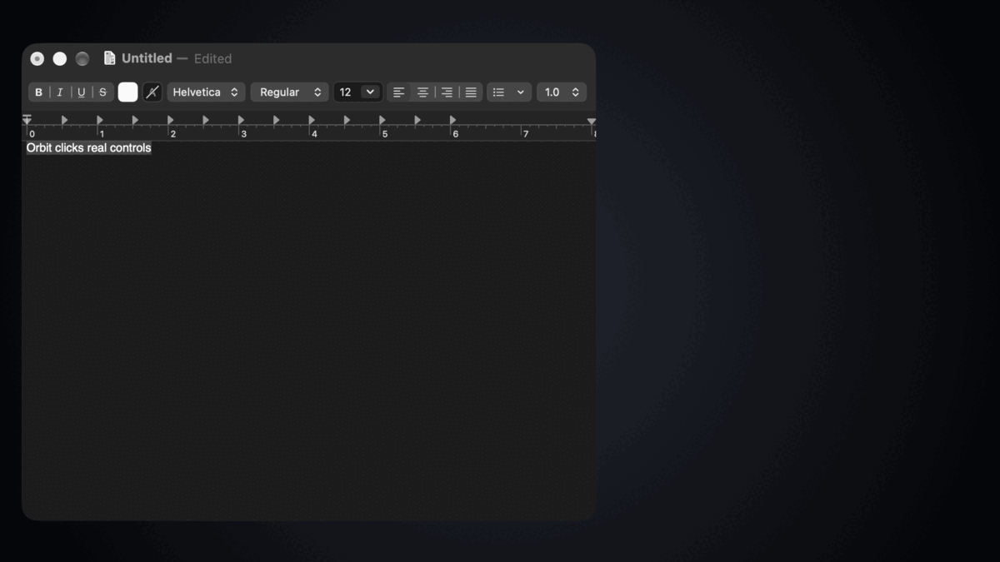

<p align="center">
  
</p>

<h1 align="center">
  <br>
  Orbit
</h1>

<p align="center"><b>Click any visible control on your Mac without touching the mouse — press ⌘E, type, hit Return.</b></p>

<p align="center">
  <a href="https://github.com/EhsanAlaviNahad/Orbit/actions/workflows/ci.yml"></a>
  <a href="https://github.com/EhsanAlaviNahad/Orbit/releases/tag/v0.4.1"></a>
  <a href="LICENSE"></a>
  
  
</p>

<p align="center">
  <a href="https://ehsanalavinahad.github.io/Orbit/">Live demo</a> ·
  <a href="#install">Install</a> ·
  <a href="#use">How to use</a> ·
  <a href="CONTRIBUTING.md">Contributing</a> ·
  <a href="https://github.com/EhsanAlaviNahad/Orbit/discussions">Discussions</a>
</p>

Orbit is a local macOS menu bar utility for clicking visible controls without leaving the keyboard. Press **Command-E**, then search by element name or visible home-row hint and press Enter.

> **The recording above is real.** It was captured from Orbit 0.4.1 on macOS 27.2 using the actual
> overlay and the actual target window. The desktop around them was replaced with a neutral backdrop
> so nothing personal appears in it.

## Live demo

**[ehsanalavinahad.github.io/Orbit](https://ehsanalavinahad.github.io/Orbit/)** — includes a browser
simulator of Orbit's real search and hint-ranking rules.

Orbit drives native macOS windows through the Accessibility API, so the app itself cannot run in a
browser. The simulator applies the same normalisation and ranking logic as `Core.swift` to a fixed
control list; use it to get a feel for search, then install the app to point it at your own windows.

## Install

```sh
curl -fsSL https://raw.githubusercontent.com/EhsanAlaviNahad/Orbit/main/Scripts/install.sh | bash
```

Then launch it:

```sh
open ~/Applications/Orbit.app
```

The installer clones the repo, builds a release bundle with `./Scripts/build-app.sh`, and installs it
to `~/Applications/Orbit.app`. It needs an Apple silicon Mac on macOS 27 or newer and the Swift 6.2
command line tools (`xcode-select --install`). It never uses `sudo`.

Prefer to read it first? [`Scripts/install.sh`](Scripts/install.sh) is about thirty lines. You can
also clone the repo and run `./Scripts/install-app.sh` yourself.

## Highlights

- Search visible controls by name or hint code, then click, double-click, or right-click without reaching for the mouse.
- Arrange the focused window through its native macOS Window menu, with Accessibility resizing as a fallback.
- Scroll the focused app while hints stay open, with a persisted speed control from 0.5× to 3×.
- Use optional on-device Vision OCR when Accessibility data is sparse or incomplete. Orbit does not send screen content or usage data off your Mac.
- Run exact `restart`, `shutdown`, and `sleep` commands only after an explicit two-Enter confirmation.

Orbit scans only the focused window. It uses macOS Accessibility for native controls and optionally fills sparse or incomplete scans with on-device Vision OCR. No data leaves the Mac.

## Requirements

- Apple silicon Mac running macOS 27
- Swift 6.2 or newer command-line tools
- Accessibility permission
- Screen Recording permission for optional OCR fallback

## Build from source

Build a release app bundle:

```sh
./Scripts/build-app.sh
open .build/Orbit.app
```

To install it for the current user, run `./Scripts/install-app.sh`. From a fresh clone:

```sh
git clone https://github.com/EhsanAlaviNahad/Orbit.git
cd Orbit
./Scripts/install-app.sh
```

Orbit appears only in the menu bar. On the first use, open Orbit Settings and grant Accessibility. Grant Screen Recording if OCR fallback is wanted. macOS may require Orbit to be restarted after either permission changes.

Always grant permissions to the installed copy at `~/Applications/Orbit.app`. Builds use the same stable bundle identifier and local designated requirement as Eclick, allowing preferences and macOS permissions to carry forward through the rename. If macOS shows a stale permission row, remove it once, add the installed Orbit app, enable it, then relaunch Orbit.

## Use

1. Focus the window containing the control.
2. Press **Command-E**.
3. Type part of the control name. Search ignores case, accents, and punctuation; for example, `settings` or `set-` matches “Settings.”
4. Press Enter to click the highlighted element or run the highlighted window command. Option-Enter double-clicks elements; Shift-Enter right-clicks them. Use Tab, Shift-Tab, Up, or Down to select another match. Option-Up and Option-Down gently scroll the focused page or app while hints remain open.
5. Every target keeps a visible home-row hint. Type either an element name or its hint, then press Enter. No modifier key is needed.
6. Press Escape or Command-E again to cancel. Backspace edits the unified search.

### Keyboard controls

| Keys | Action |
| --- | --- |
| Enter | Left-click the selected target |
| Option-Enter | Double-click the selected target |
| Shift-Enter | Right-click the selected target |
| Tab / Shift-Tab / Up / Down | Select the next / previous match |
| Option-Up / Option-Down | Scroll the focused app while hints stay open |
| Escape / Command-E | Cancel hint mode |

Option-Arrow scrolling uses a wheel event at the center of the active window. Adjust its distance per keypress from 0.5× to 3× with the Scroll Speed slider in Orbit Settings; 1× preserves the default behavior.

Accessibility controls use their semantic action when possible. Other targets receive a left click at their center, which moves the pointer. OCR text is only added where it does not overlap an Accessibility target; some detected text may not actually be clickable.

Visible Dock items also receive hints. Activating one uses its Accessibility action to open or switch to the application.

Window arrangement lives in the same search box. Search for `left`, `right`, `top`, `bottom`, `center`, `fill`, `maximize`, or `full screen`, then press Enter. Orbit invokes the matching macOS Window menu command when available, preserving system tiling gaps, Stage Manager behavior, the menu bar, and the Dock; direct Accessibility resizing remains a fallback.

Exact system commands are also available: `restart`, `shutdown`, and `sleep`. Matching ignores surrounding whitespace and letter case but never uses fuzzy search, so text such as `restart now` remains an ordinary search. Each command requires two complete plain Enter presses; changing the query, pressing Escape, closing the overlay, or changing modifiers cancels the pending confirmation. Restart and shutdown then show macOS's native confirmation dialog.

The Settings window can change the global shortcut, scroll speed, hint-label size and color, show permission status, and enable launch at login. Scroll speed and hint-label choices persist across launches. Hint labels include built-in appearances plus a persistent custom color with automatic readable text. A shortcut must contain Command, Control, or Option. If another utility already owns it, Orbit keeps the previous working shortcut.

Search reads direct keyboard events so the overlay can remain non-activating. Standard keyboard layouts work; IME and dead-key composition are not supported in the search overlay.

## Test

The installed command-line toolchain does not include a usable XCTest runtime, so the core tests compile and run as a standalone Swift executable:

```sh
./Scripts/test-core.sh
```

The tests cover home-row code boundaries, prefix safety, search normalization and ranking, Option-Arrow scroll classification, speed normalization, and wheel-event construction, exact system-command parsing and confirmation, mock-only system execution, hint color validation and contrast selection, geometry validation, Accessibility/OCR merging, and window arrangement geometry.

## Update or uninstall

Run `./Scripts/install-app.sh` again to replace the installed bundle. Version 0.2 and later preserve a stable local identity across rebuilds.

To uninstall, quit Orbit and move `~/Applications/Orbit.app` to Trash. Disable “Launch at login” first if it was enabled.

### What CI covers

CI runs `./Scripts/test-core.sh` on a macOS runner, plus shell syntax checks, `Info.plist`
validation, and a check that the licence, changelog, and contributing guide are present.

The app bundle is **not** built in CI. `Package.swift` declares `.macOS("27.0")` and no
GitHub-hosted runner ships a macOS 27 SDK, so a full build there would fail for environmental
reasons rather than real defects. Build the app locally with `./Scripts/build-app.sh`, or register a
macOS 27 machine as a self-hosted runner if you want that job covered in CI.

## Contributing

Start with [CONTRIBUTING.md](CONTRIBUTING.md). New here? The
[`good first issue` label](https://github.com/EhsanAlaviNahad/Orbit/labels/good%20first%20issue)
lists tasks with the investigation already written down. Questions belong in
[Discussions](https://github.com/EhsanAlaviNahad/Orbit/discussions) rather than issues.

Report vulnerabilities privately through [SECURITY.md](SECURITY.md).

## Licence

Orbit is released under the [MIT License](LICENSE). It is an independent project, not affiliated
with or endorsed by Apple. macOS, Accessibility, and Vision are Apple technologies used as designed.
